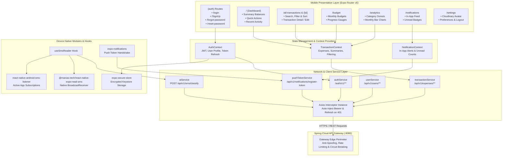
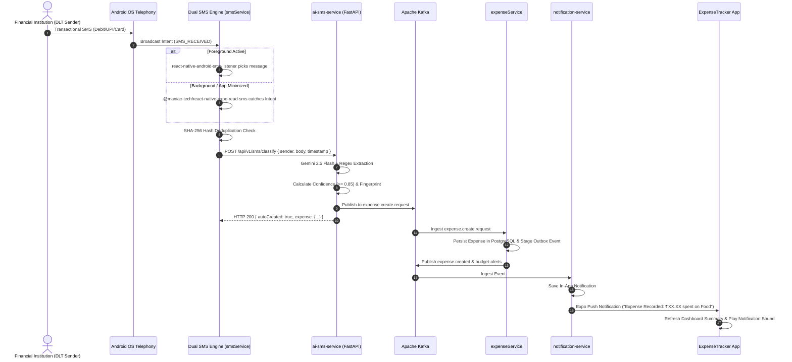

# ExpenseTracker Mobile Client (`expense_tracker`)

> A high-performance, cross-platform financial tracking and automated expense accounting mobile application built with **React Native 0.81**, **Expo 54 (Expo Router v6)**, **TypeScript**, and **NativeWind (Tailwind CSS)**. Features automated background SMS financial transaction extraction, real-time push notifications, interactive charts, category budgeting, and zero-trust JWT authentication.

---

## 📱 Application Overview & Key Capabilities

The **ExpenseTracker Mobile App** acts as the client-facing touchpoint for the distributed microservices ecosystem. It eliminates manual bookkeeping through automated, on-device financial SMS detection powered by Gemini 2.5 Flash and deterministic heuristic fallback.

- 🤖 **Zero-Touch Financial SMS Ingestion**: Real-time dual-listener on Android (`react-native-android-sms-listener` for active foreground and `@maniac-tech/react-native-expo-read-sms` with `RECEIVER_EXPORTED` for minimized background operation).
- 🔐 **Hardened JWT & Refresh Token Lifecycle**: Seamless token rotation via Axios request/response interceptors with secure storage (`expo-secure-store`).
- 🔔 **Instant Push & In-App Notifications**: Full integration with `expo-notifications`, badge indicators, unread counters, and instant transaction confirmation.
- 📊 **Dynamic Financial Analytics**: Interactive monthly trend charts and category spending breakdowns powered by `react-native-chart-kit`.
- 🎯 **Category Budgets & Visual Guardrails**: Configurable monthly budget limits with color-coded consumption bars and automated 80% / 100% threshold alert badges.
- 👤 **Profile & Media Asset Management**: Cloudinary-backed user avatar uploads via native camera/gallery picker (`expo-image-picker`).

---

## 🏗️ Architecture & Component Hierarchy



---

## 🔄 Dual-Listener SMS Auto-Detection Flow



---

## 📂 Project Directory Structure

```text
expense_tracker/
├── app/                                # Expo Router File-Based Routing
│   ├── _layout.tsx                     # Root App Layout (Fonts, Theme, Global Providers)
│   ├── global.css                      # NativeWind / Tailwind CSS Root Directives
│   ├── (auth)/                         # Authentication Route Group (Unauthenticated)
│   │   ├── _layout.tsx                 # Auth Stack Configuration
│   │   ├── login.tsx                   # User Login Screen with Secure Token Storage
│   │   ├── SignUp.tsx                  # New User Registration Screen
│   │   ├── forgot-password.tsx         # Password Reset Request (Brevo Email Trigger)
│   │   └── reset-password.tsx          # Token-based Password Reset Form
│   ├── (root)/                         # Authenticated Main App Stack
│   │   ├── _layout.tsx                 # Tab Navigation & Header Definitions
│   │   ├── index.tsx                   # Main Dashboard (Summary Cards, Recent Tx)
│   │   ├── all-transactions.tsx        # Paginated Transaction Ledger with Filter Modals
│   │   ├── create.tsx                  # Manual Transaction Creation Screen
│   │   ├── analytics.tsx               # Category Breakdown Donut & Monthly Bar Charts
│   │   ├── budget.tsx                  # Budget Planner & Visual Threshold Meters
│   │   ├── notifications.tsx           # In-App Notification Center with Badge Counts
│   │   └── settings.tsx                # Profile Management, Cloudinary Avatar Upload
│   └── transactions/
│       └── [id].tsx                    # Dynamic Route: Transaction Inspection & Edit
├── services/                           # API & Hardware Integration Services
│   ├── api.ts                          # Axios Client with Auto-Refresh Interceptors
│   ├── authService.ts                  # Authentication Endpoints
│   ├── userService.ts                  # User Profile & Cloudinary Avatar Uploads
│   ├── transactionService.ts           # Expense & Budget Management Endpoints
│   ├── aiService.ts                    # AI SMS Classification Endpoint
│   ├── smsService.ts                   # Dual-Engine SMS Ingestion & Filter Engine
│   ├── pushTokenService.ts             # Expo Push Token Registration Service
│   └── notificationService.ts          # In-App Notification Queries & Read Actions
├── context/                            # Global React Context State Handlers
│   ├── AuthContext.tsx                 # Auth Session & Token State
│   ├── TransactionContext.tsx          # Real-Time Ledger State
│   └── NotificationContext.tsx         # Notification Badges & Pollers
├── hooks/                              # Custom React Hooks
│   ├── useSmsReader.ts                 # Lifecycle Hook for Native SMS Receivers
│   └── useThemeColor.ts                # Dynamic Light/Dark Theme Utilities
├── components/                         # Modular Reusable UI Components
│   ├── TransactionCard.tsx             # Animated Transaction Row Item
│   ├── BudgetProgress.tsx              # Dynamic SVG/View Progress Bar
│   ├── FilterModal.tsx                 # Date, Category & Type Filter Sheet
│   └── AnalyticsChart.tsx              # React Native ChartKit Wrapper
├── constants/                          # System Configuration & Color Tokens
│   ├── Colors.ts                       # HSL/Tailwind Unified Palette
│   └── Categories.ts                   # Financial Categories & Icon Mapping
└── app.json                            # Expo Application Manifest & Android Permissions
```

---

## 🛠️ Technology Stack & Dependencies

| Category | Technology | Purpose |
| :--- | :--- | :--- |
| **Core Framework** | `React Native 0.81.5` / `React 19.1.0` | Mobile Runtime Environment |
| **Platform Suite** | `Expo ~54.0.32` | Cross-Platform Tooling & Native Modules |
| **Navigation** | `expo-router ~6.0.23` | File-System Based Deep-Linked Navigation |
| **Styling** | `nativewind ^4.2.1` / `tailwindcss ^3.4.19` | Utility-First Styling System |
| **Data Fetching** | `axios ^1.13.5` | HTTP Client with Custom Interceptors |
| **Secure Storage** | `expo-secure-store ~15.0.8` | Hardware-Backed Keychain & KeyStore |
| **SMS Ingestion** | `react-native-android-sms-listener`<br>`@maniac-tech/react-native-expo-read-sms` | Dual Foreground & Background SMS Telephony |
| **Push Notifications** | `expo-notifications ~0.32.16` | Remote Push Dispatch & Local Alert Handling |
| **Charts & Data Viz** | `react-native-chart-kit ^6.12.3` | Financial Analytics, Donut & Bar Charts |
| **Animation & Gestures** | `react-native-reanimated ~4.1.1`<br>`react-native-gesture-handler ~2.28.0` | 60 FPS Native Animations & Smooth Swiping |
| **Media & Images** | `expo-image-picker ~17.0.10` / `expo-image ~3.0.11` | Avatar Capture & High-Performance Caching |

---

## ⚙️ Android Native Configuration (`app.json`)

To enable zero-touch financial SMS auto-detection, the following Android telephony permissions and intent filters are configured in `app.json`:

```json
{
  "expo": {
    "name": "expense_tracker",
    "slug": "expense_tracker",
    "android": {
      "package": "com.greatest.expensetracker",
      "permissions": [
        "android.permission.RECEIVE_SMS",
        "android.permission.READ_SMS",
        "android.permission.INTERNET",
        "android.permission.CAMERA",
        "android.permission.READ_EXTERNAL_STORAGE",
        "android.permission.WRITE_EXTERNAL_STORAGE"
      ]
    },
    "plugins": [
      "expo-router",
      "expo-secure-store",
      "expo-notifications"
    ]
  }
}
```

> ⚠️ **Telecom DLT & SMS Testing Note:**  
> In India (TRAI regulations), carrier firewalls block P2P personal SIM messages containing banking keywords like `debited`, `a/c`, or `INR`. Real-world transactions from registered bank header sender IDs (e.g., `HDFCBK`, `SBIN`, `SWIGGY`) pass through instantly and are parsed with 0.99 confidence.

---

## 🚀 Getting Started & Local Development

### 1. Prerequisites
- **Node.js** (v20+ recommended)
- **npm** or **yarn**
- **Android Studio** (with Android SDK 34+ and physical device or emulator)
- Active running microservices backend (`gateway` accessible on local network)

### 2. Install Dependencies
```bash
cd expense_tracker
npm install
```

### 3. Configure API Endpoint
In `services/api.ts` (or `.env`), set the API Gateway URL:
```typescript
// Replace with your local machine's IP address when running on physical device
export const BASE_URL = 'http://192.168.1.X:8080';
```

### 4. Running the Development Build
Because native telephony modules (`react-native-android-sms-listener`) require Android native code, run with **Expo Prebuild / Dev Client**:

```bash
# Clean cache and start Metro bundler
npx expo start -c

# Run on connected Android device / emulator
npm run android
```

---

## 🔒 Security & Resilience Design

1. **Anti-Tampering Token Refresh**:
   - Access tokens are kept in memory and backed by `expo-secure-store`.
   - On encountering `401 Unauthorized`, an Axios response interceptor holds failing requests in a FIFO retry queue, issues a refresh request to `/auth/v1/refresh-token`, updates credentials, and transparently replays original requests without logging out the user.
2. **Duplicate SMS Throttling**:
   - In-memory circular buffer and deterministic message fingerprint hashing ensure that concurrent broadcasts of the same SMS are never forwarded to the backend multiple times.
3. **Graceful Degradation UX**:
   - If network connectivity is lost or upstream AI processing falls back, manual entry remains 100% available with offline-safe form validation and immediate feedback toasts.
